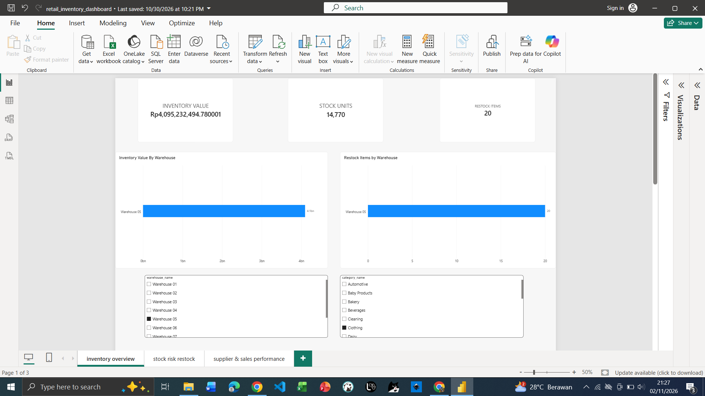
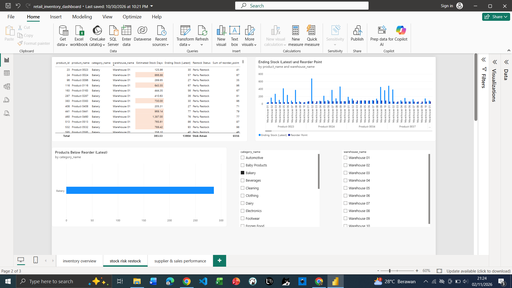
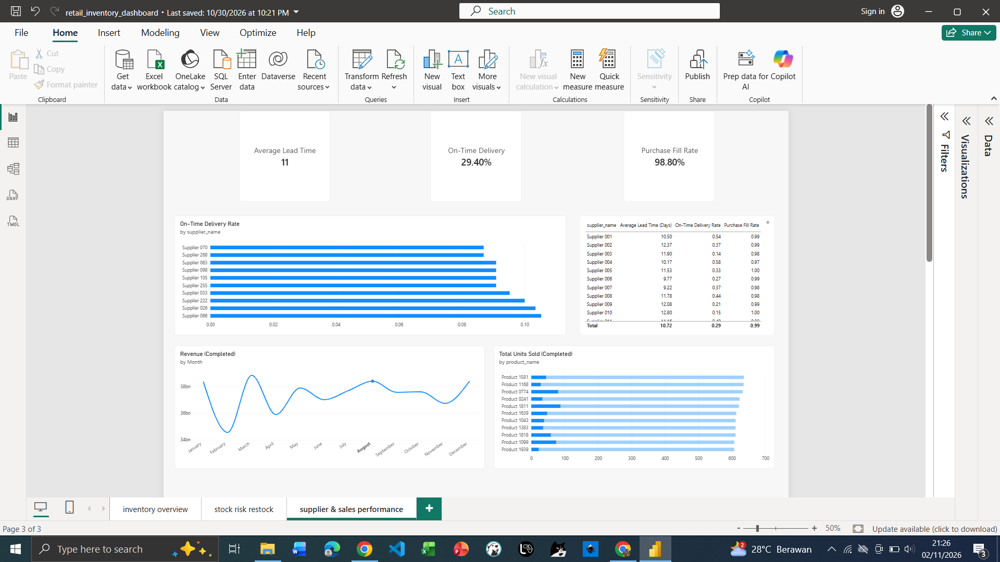

# Retail Inventory & Supply Chain Analytics

## Project Overview

This project analyzes retail inventory, sales, purchasing, and supplier performance using a synthetic dataset representing a retail supply chain operation throughout 2025.

The goal is to identify inventory risks, evaluate supplier delivery performance, analyze sales trends, and provide actionable recommendations to support operational decision-making.

## Business Problems

- Which warehouses hold the highest inventory value?
- Which product–warehouse combinations require restocking?
- Which suppliers have the lowest on-time delivery rates?
- How do monthly sales and product demand vary throughout the year?
- How can inventory and purchasing decisions be improved?

## Dataset

The dataset contains 9 CSV files with **514,482 total rows**.

| Dataset              |    Rows |
| -------------------- | ------: |
| Categories           |      20 |
| Suppliers            |     300 |
| Products             |   2,000 |
| Warehouses           |      10 |
| Sales Orders         |  60,000 |
| Sales Order Items    | 180,076 |
| Purchase Orders      |   8,000 |
| Purchase Order Items |  24,086 |
| Inventory Snapshots  | 240,000 |

The data is synthetic and was generated for analytical and portfolio purposes.

## Tools & Technologies

- **SQL / MySQL** — Data quality checks and business analysis
- **Python** — Pandas-based data analysis and exploratory data analysis
- **Google Colab** — Dataset generation and notebook execution
- **Power BI** — Data modeling, DAX measures, interactive dashboards
- **GitHub** — Project documentation and version control

## Analysis

### SQL Analysis

- Data quality validation
- Latest inventory valuation by warehouse
- Low-stock and restocking analysis
- Supplier lead time, on-time delivery, and purchase fill rate
- Monthly sales trends
- Top-selling products

### Python EDA

- Dataset structure and missing-value checks
- Primary-key and data consistency validation
- Monthly sales and profitability analysis
- Inventory valuation and restocking risk analysis
- Estimated stock coverage based on historical demand

### Power BI Dashboard

**Page 1 — Inventory Overview**

- Latest inventory value
- Total stock units
- Product–warehouse combinations below reorder point
- Inventory value by warehouse
- Restocking requirements by warehouse

**Page 2 — Stock Risk & Restock**

- Low-stock product prioritization
- Stock versus reorder point
- Estimated days of stock remaining
- Warehouse and category filters

**Page 3 — Supplier & Sales Performance**

- Average supplier lead time
- On-time delivery rate
- Purchase fill rate
- Monthly revenue trends
- Top-selling products

## Key Findings

- The December 2025 inventory value was approximately **Rp1.016 trillion**.
- **4,455 out of 20,000 product–warehouse combinations (22.28%)** were at or below their reorder points.
- Warehouse 08 had the highest inventory value, approximately **Rp107.48 billion**.
- March recorded the highest monthly revenue, while February recorded the lowest.
- Product 1581 recorded the highest unit sales among individual products, with 636 units sold.

## Business Recommendations

1. Prioritize replenishment for products with low stock coverage and stock levels at or below reorder points.
2. Review inventory allocation across warehouses to reduce the risk of excess stock in one location and shortages in another.
3. Evaluate suppliers with low on-time delivery rates and review purchasing and delivery agreements.
4. Use monthly sales trends and product demand to support purchasing and inventory planning.

## Project Limitations

- The dataset is synthetic and does not represent an actual company's operational records.
- Estimated stock coverage is based on historical demand and should not be treated as a precise forecast.
- Reorder thresholds and operational recommendations are analytical starting points that may require business-specific calibration.

## Repository Structure

- `data/` — CSV datasets
- `sql/` — SQL business analysis
- `notebooks/` — Dataset generation and Python EDA notebooks
- `powerbi/` — Power BI dashboard
- `screenshots/` — Dashboard screenshots

### Inventory Overview

### Stock Risk & Restock

### Supplier & Sales Performance

## Author

**Data Analytics Portfolio Project**

This project demonstrates practical skills in SQL, Python, data validation, business analysis, data modeling, DAX, and Power BI dashboard development.
